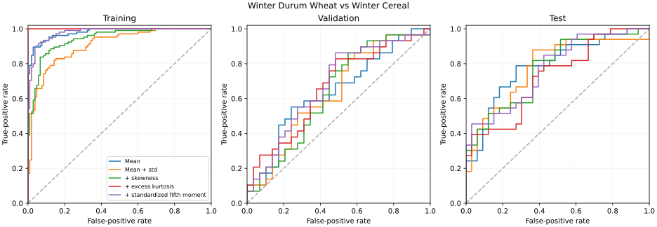
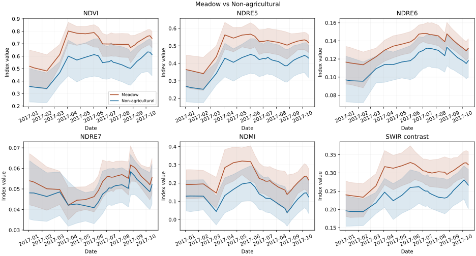
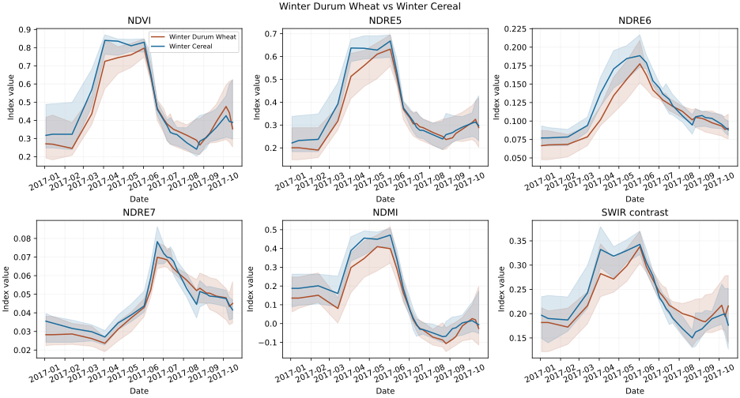

# Exploring Improvements of the PSE TAE Method for Crop Satellite Image Time Series Classification

This repository proposes an improvement of the method for classifying crops on satellite images from [Garnot et al.](https://openaccess.thecvf.com/content_CVPR_2020/papers/Garnot_Satellite_Image_Time_Series_Classification_With_Pixel-Set_Encoders_and_Temporal_CVPR_2020_paper.pdf):

| Model | Test mIoU | Test OA | Test average recall |
|---|---:|---:|---:|
| Original PSE+TAE | 51.31 | 94.24 | 58.35 |
| L-TAE (our reproduction) | 49.99 | 94.32 | 56.26 |
| Our distilled baseline-size student | 53.35 | 94.66 | 60.70 |
| Our nine-model distillation teacher | 54.93 | **95.03** | 61.21 |
| Our eight-model ensemble | **54.98** | 94.96 | **61.48** |

These results are only measured on the test split of the first fold.

Further on here we document a set of experiments and provide scripts for reproducing them.

<details>
<summary>Setup</summary>

For training neural networks we used an on-demand machine with an L40 GPU.

We use Python 3.12 and PyTorch 2.11.0+cu128. Evaluation runs on CPU by default.

Install CPU requirements (Linux):
```bash
python3.12 -m venv .venv
source .venv/bin/activate
pip install torch==2.11.0 --index-url https://download.pytorch.org/whl/cpu
pip install -r requirements.txt
```

Install GPU requirements (Linux with an NVIDIA driver supporting CUDA 12.8):

```bash
python3.12 -m venv .venv
source .venv/bin/activate
pip install torch==2.11.0 --index-url https://download.pytorch.org/whl/cu128
pip install -r requirements.txt
```

On macOS, use the CPU instructions with `pip install torch==2.11.0` instead of the CPU index URL. [PyTorch installation reference](https://pytorch.org/get-started/previous-versions/).

Download the datasets:

```
bash scripts/download_dataset.sh data
```
Download the separate [pixel-patch archive](https://zenodo.org/records/5815523) for the spatial and TGT experiments (about 10.8 GB compressed; requires `7z` or `7zz`):

```bash
# Ubuntu: sudo apt install p7zip-full; macOS: brew install sevenzip
bash scripts/download_pixel_patches.sh data
```

The script resumes downloads, verifies the published checksum and exposes `data/s2-2017-IGARSS-NNI-NPY/DATA`.


Download the checkpoints:

```bash
pip install huggingface_hub
hf auth login
python scripts/hf_checkpoints.py download --repo-id ldmberman/pse-tae-experiments --folder artifacts/hf
python scripts/hf_checkpoints.py restore --folder artifacts/hf --destination .
```


Reproduce the starting models, or evaluate restored checkpoints:

```bash
for method in baseline ltae; do
  for fold in 1 2 3 4 5; do
    python scripts/reproduce.py "$method" train --fold "$fold"
    python scripts/reproduce.py "$method" evaluate --fold "$fold"
  done
done
python scripts/reproduce.py baseline plots --fold 1
```


</details>

## Research Log

1. [Assess decision thresholds](#step-1)
2. [Think about missing information](#step-2): moments, reflectance properties and temporal trajectories
3. [Fit logistic regression and XGBoost on frozen embeddings and new features](#step-3)
4. [Train small additive corrections to the baseline](#step-4)
5. [Try a bigger model](#step-5)
6. [Try temporal dropout](#step-6)
7. [Train promising combinations from scratch](#step-7)
8. [Mix models, select the best ensemble and distill a baseline-sized model](#step-8)

<a id="step-1"></a>

### 1. Assess decision thresholds

We explored adding bias terms (`prediction = argmax_c(logit_c + bias_c)`) to individual classes and a joint frequency-based bias based on the [logit adjustment paper](https://arxiv.org/abs/2007.07314) - `bias_c = -tau * log(training_frequency_c)`.

Sweeping over `bias_c`'s and `tau`'s (from 0 to 2.5 in steps of 0.05) we selected the best mIoU, OA pair on the validation set.

| Rule | Validation mIoU | Validation OA | Test mIoU | Test OA | Test average recall |
|---|---:|---:|---:|---:|---:|
| Baseline | 51.24 | 94.27 | 51.31 | 94.24 | 58.35 |
| Frequency-based adjustment, tau = 0.1 | 51.74 | 93.74 | 51.25 | 93.65 | **61.82** |
| Best single-class adjustment | 51.71 | 94.42 | 51.36 | **94.30** | 58.34 |
| Greedy joint adjustment | 52.57 | **94.45** | **51.68** | 94.28 | 58.65 |
| Extended search, validation OA constrained | **53.37** | 94.43 | 51.58 | 94.15 | 59.36 |

Moving the decision threshold does not seem to help the model much.

[Interactive precision-recall plot](https://ldmberman.github.io/pse-tae/)

<details>
<summary>Reproduce</summary>

```bash
# Restore/extract baseline embeddings and logits with the stage-3 recipe first.
python scripts/build_pr_explorer.py extract
python scripts/sweep_class_biases.py fit
python scripts/sweep_class_biases.py evaluate
python scripts/search_class_biases.py fit
python scripts/search_class_biases.py evaluate
python scripts/build_pr_explorer.py build
```

</details>

<a id="step-2"></a>

### 2. Think about missing information

We first sorted confusion pairs by its isolated influence on mIoU gain on the validation dataset.

| Rank | True class, predicted class | Validation errors | Isolated mIoU gain in points |
|---|---|---:|---:|
| 1 | Winter Durum Wheat, Winter Cereal | 22 | 3.077 |
| 2 | Orchard, Meadow | 28 | 2.806 |
| 3 | Leguminous Fodder, Meadow | 249 | 1.861 |
| 4 | Woodlands, Meadow | 17 | 1.774 |
| 5 | Cereal, Winter Cereal | 66 | 1.652 |

#### 2a. Moments

We considered whether mean and standard deviation miss useful pixel statistics. For the top pair, we fitted logistic probes with progressively added skewness, excess kurtosis and standardized fifth moments, controlling for parcel sizes.



The probes fit training parcels much better than held-out parcels, consistent with overfitting.

| Statistics | Train ROC-AUC | Validation ROC-AUC | Test ROC-AUC | Test AP |
|---|---:|---:|---:|---:|
| Mean | 0.980 | 0.637 | **0.786** | 0.800 |
| Mean + std | 0.906 | 0.635 | 0.780 | 0.796 |
| + skewness | 0.942 | 0.637 | 0.771 | 0.797 |
| + excess kurtosis | **1.000** | 0.662 | 0.726 | 0.764 |
| + standardized fifth moment | 0.979 | **0.675** | 0.770 | **0.803** |

#### 2b. Reflectance properties

Next we looked at reflectance summaries.



These plots show medians and the middle half of the size-matched test parcels. They seem to have some discrimination power.

| Index | Formula | Interpretation |
|---|---|---|
| NDVI | `(B8 - B4) / (B8 + B4)` | Vegetation greenness |
| NDRE5/6/7 | `(B8A - Bj) / (B8A + Bj)`, j=5,6,7 | Red-edge contrasts sensitive to vegetation and chlorophyll |
| NDMI | `(B8A - B11) / (B8A + B11)` | Canopy-moisture-sensitive contrast |
| SWIR contrast | `(B11 - B12) / (B11 + B12)` | Differences influenced by water, dry matter and soil |

The baseline does receive this information indirectly but in theory may fail to learn to use it.

The same indices for the top mIoU-impact pair:



#### 2c. Temporal trajectories

Pooling pixels independently at each date loses individual pixel trajectories. We tried summarizing or encoding each trajectory before spatial aggregation, then grouping nearby pixels to save resources. We call the grouped approach Temporal Group Trajectories (TGT). We also considered CNN pooling to capture local spatial patterns.

<details>
<summary>Reproduce</summary>

```bash
python scripts/xgb_moments.py prepare --output results/xgboost --workers 2
# Build the baseline cache with the stage-3 extraction command.
python scripts/probe_confusion_pairs.py prepare
python scripts/probe_confusion_pairs.py fit
python scripts/probe_confusion_pairs.py evaluate
python scripts/probe_confusion_pairs.py baseline --pair 1_4
python scripts/probe_confusion_pairs.py plot
```

</details>

<a id="step-3"></a>

### 3. Fit logistic regression and XGBoost on frozen embeddings and new features

We first tested new information without retraining the baseline. We combined frozen embeddings with band statistics, index values, changes between dates and seasonal summaries.

| Model, fold-1 test | mIoU | OA | Average recall |
|---|---:|---:|---:|
| Original baseline decoder | 51.31 | 94.24 | 58.35 |
| Logistic regression: embeddings | 50.53 | 94.16 | 57.44 |
| Logistic regression: embeddings + spectral summaries | 51.80 | **94.36** | 58.23 |
| XGBoost: embeddings | 50.91 | 93.00 | **61.66** |
| XGBoost: embeddings + spectral summaries | **52.23** | 93.51 | 61.62 |

<details>
<summary>Reproduce</summary>

```bash
# Extract the own-fold frozen embeddings and logits.
python scripts/frozen_pair_probes.py --dataset data/S2-2017-T31TFM-PixelSet --baseline results/baseline --moments results/xgboost --output results/pair_probes --fold 1 --stage extract
python scripts/frozen_pair_probes.py --dataset data/S2-2017-T31TFM-PixelSet --baseline results/baseline --moments results/xgboost --output results/pair_probes --fold 1 --stage fit
python scripts/frozen_multiclass_probes.py --cache results/pair_probes --output results/multiclass_probes --fold 1
python scripts/evaluate_tabular.py --checkpoint results/multiclass_probes/Fold_1/combined_xgb_sqrt_5.joblib --fold 1 --output outputs/xgboost_combined
python scripts/plot_predictions.py outputs/xgboost_combined/predictions.npz --output outputs/xgboost_combined/plots
# For another classifier, replace the checkpoint path with its saved joblib.
```

</details>

<details>
<summary>Control: XGBoost on band statistics without embeddings</summary>

<!-- XGB_60_20_20_RESULTS -->

Five folds: held-out test, mean ± sample standard deviation.

| Model | Test mIoU | Test OA | Test average recall |
|---|---:|---:|---:|
| PSE+TAE reproduction | **50.96** ± 0.60 | **94.22** ± 0.09 | **58.50** ± 0.94 |
| XGBoost: band mean/std | 41.40 ± 0.29 | 93.04 ± 0.11 | 44.72 ± 0.32 |
| XGBoost: band mean/std + kurtosis | 40.87 ± 0.37 | 93.13 ± 0.12 | 44.04 ± 0.39 |
| Paper's random forest | 32.5 | 91.6 | - |

[Per-fold scores, selected rounds, partitions and checkpoint hashes](records/xgboost_60_20_20.json).

<!-- END_XGB_60_20_20_RESULTS -->

```bash
python scripts/xgb_moments.py train --features results/xgboost --output outputs/xgboost_60_20_20 --workers 2
python scripts/xgb_moments.py evaluate --features results/xgboost --output outputs/xgboost_60_20_20 --workers 2
python scripts/record_xgb_results.py --features results/xgboost
```

</details>

<a id="step-4"></a>

### 4. Train small additive neural corrections

We kept the baseline frozen and trained a small network on its embeddings and new features. It adds correction logits to the baseline logits. Its final layer starts at zero, so training begins with the baseline's predictions.

| Model | Validation mIoU | Validation OA | Test mIoU | Test OA | Test average recall |
|---|---:|---:|---:|---:|---:|
| Original baseline | 51.24 | 94.27 | 51.31 | 94.24 | 58.35 |
| Static per-pixel temporal summaries | 51.68 | 94.41 | 51.15 | 94.35 | 57.67 |
| Small per-pixel temporal attention | 51.72 | 94.46 | 51.78 | 94.39 | 58.72 |
| Small temporal + spatial attention | 51.35 | **94.49** | **51.80** | **94.40** | 58.70 |
| Larger embedding-only control | 51.42 | 94.36 | 51.56 | 94.34 | **58.97** |
| TGT correction | 51.73 | 94.39 | 51.24 | 94.24 | 58.41 |
| CNN spatial correction | 51.75 | 94.45 | 51.28 | 94.34 | 58.41 |
| CNN+TGT correction | **51.88** | 94.43 | 51.65 | 94.37 | 58.66 |

The gains were small and depended on the branch. TGT's validation improvement did not carry to test.

<details>
<summary>Reproduce</summary>

```bash
python scripts/frozen_trajectory_probes.py prepare --source native --cache results/pair_probes --trajectories results/frozen_trajectories/native_cache --device cpu
python scripts/frozen_trajectory_probes.py prepare --source patch --cache results/pair_probes --patch-trajectories results/frozen_trajectories/patch_cache --device cpu
for method in correction_static correction_patch_temporal correction_spatial_nopos tgt_control tgt_correction cnn_spatial cnn_tgt; do
  python scripts/reproduce.py "$method" train --fold 1
  python scripts/reproduce.py "$method" evaluate --fold 1
  python scripts/reproduce.py "$method" plots --fold 1
done
```

</details>

<a id="step-5"></a>

### 5. Try a bigger model

We increased capacity without adding new features, as a control for larger temporal models we tried.

| Model | Snapshot epoch | Validation mIoU | Test mIoU | Test OA |
|---|---:|---:|---:|---:|
| Patch baseline | 38 | 50.75 | **50.48** | **94.38** |
| Capacity control | 67 | 51.69 | 50.16 | 94.10 |
| Large capacity control | 45 | **52.06** | - | - |

The measured capacity control improved validation but not test.

<details>
<summary>Reproduce</summary>

```bash
for method in patch_baseline capacity capacity_large; do
  python scripts/reproduce.py "$method" train --fold 1
done
python scripts/reproduce.py capacity evaluate --fold 1
python scripts/reproduce.py capacity plots --fold 1
```

</details>

<a id="step-6"></a>

### 6. Try temporal dropout

We fine-tuned the capacity control checkpoint while randomly omitting dates.

| Model, fold-1 test | mIoU | OA | Average recall |
|---|---:|---:|---:|
| Starting capacity checkpoint | 50.16 | 94.10 | 58.01 |
| Date-dropout fine-tuning | **51.67** | **94.42** | **58.78** |

<details>
<summary>Reproduce</summary>

```bash
python scripts/reproduce.py date_dropout train --fold 1 --source results/complementarity/snapshot_20261018_1605/capacity/best.pt
python scripts/reproduce.py date_dropout evaluate --fold 1
python scripts/reproduce.py date_dropout plots --fold 1
```

</details>

<a id="step-7"></a>

### 7. Train promising combinations from scratch

We trained temporal models from scratch, then combined CNN pooling, temporal attention and date dropout. These experiments changed several architectural choices together, so do not properly isolate the usefulness of any one feature.

| Model, fold-1 test | mIoU | OA |
|---|---:|---:|
| Patch baseline, ensemble snapshot | **50.48** | **94.38** |
| Small per-pixel temporal attention | 48.11 | 93.73 |
| Small temporal + spatial attention | 49.20 | 94.03 |
| TGT, ensemble snapshot | 49.44 | 93.98 |

<details>
<summary>Reproduce</summary>

```bash
for method in pixel_temporal pixel_temporal_spatial_nopos tgt cnn_ta_td_large; do
  python scripts/reproduce.py "$method" train --fold 1
  python scripts/reproduce.py "$method" evaluate --fold 1
  python scripts/reproduce.py "$method" plots --fold 1
done
```

</details>

<a id="step-8"></a>

### 8. Mix models, search ensembles and distill a single model

We averaged model outputs to test whether errors were complementary, with a baseline-checkpoint ensemble as a control.

We searched for the best ensemble by greedily choosing the best single addition by validation mIoU and continuing on to the next iteration as described in [Ensemble Selection from Libraries of Models](https://www.cs.cornell.edu/~alexn/papers/shotgun.icml04.revised.rev2.pdf).

| Model, fold-1 test | mIoU | OA | Average recall |
|---|---:|---:|---:|
| Original baseline | 51.31 | 94.24 | 58.35 |
| Three baseline checkpoints | 51.61 | 94.67 | 57.47 |
| Patch baseline + capacity + TGT | 52.28 | 94.76 | 57.80 |
| Previous three + date dropout | 52.62 | 94.80 | 58.02 |
| Previous four + XGBoost | 53.72 | 94.88 | 59.58 |
| Previous five + CNN → TGT | 54.24 | 94.97 | 60.06 |
| Nine-model teacher | **54.93** | **95.03** | **61.21** |

#### Return to a single baseline-size model

We distilled our best ensemble into a fresh baseline-size PSE+TAE student alongside an identically initialized ground-truth-only control. The student loss was `0.5 CE + 0.5 T² KL(teacher_T || student_T)`, with the temperature=2.

| Model, fold-1 test | mIoU | OA | Average recall |
|---|---:|---:|---:|
| Original baseline | 51.31 | 94.24 | 58.35 |
| Matched CE-only control | 51.68 | 94.43 | 58.47 |
| Distilled baseline-size student | **53.35** | **94.66** | **60.70** |

<details>
<summary>Reproduce</summary>

```bash
python scripts/evaluate_ensemble.py baseline_checkpoints --fold 1
python scripts/evaluate_ensemble.py eight --fold 1
python scripts/plot_predictions.py outputs/ensembles/eight/test/predictions.npz --output outputs/ensembles/eight/plots
# Distill from the original nine-model teacher's TRAIN predictions.
python scripts/evaluate_ensemble.py nine --fold 1 --split train
python scripts/reproduce.py distilled train --fold 1 --teacher outputs/ensembles/nine/train/predictions.npz
python scripts/reproduce.py ce_control train --fold 1 --teacher outputs/ensembles/nine/train/predictions.npz
python scripts/reproduce.py distilled evaluate --fold 1
python scripts/reproduce.py distilled plots --fold 1
```

</details>

